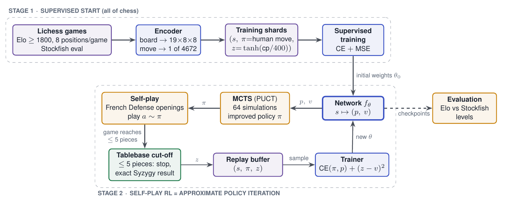
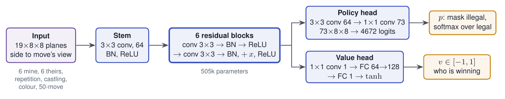
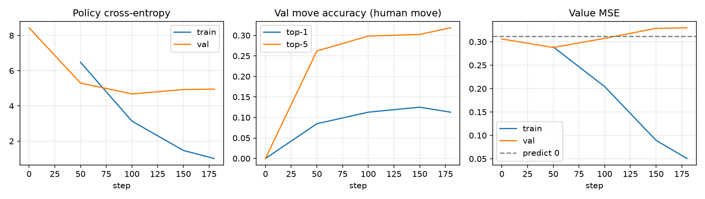

# Encoding, network and training: explainer

This document explains Samyak's track in plain language, with worked examples: how a chess
position becomes numbers, what the network computes, how it learns from Lichess games, and how
self-play reinforcement learning will improve it in Phase 2.

For the exact contracts, see [`INTERFACES.md`](INTERFACES.md) §1–3 and §5–6. The theory behind
values and Bellman backups is in Vatsl's
[Endgame DP Primer](Vatsl_Endgame_DP_Primer.html); the search side is in Agriya's
[explainer](Agriya_Phase1_Search_Eval_Explainer.md).

## The result in one paragraph

A position is turned into **19 planes of 8×8 numbers**, always seen from the side to move. Every
possible move gets a **fixed number between 0 and 4,671**. A **6-block residual network** reads the
planes and outputs a score for each of the 4,672 moves (the *policy*) and one number in [−1, 1]
for who is winning (the *value*). The **supervised trainer** teaches it to predict the human's move
and Stockfish's evaluation on Lichess positions. A 5,000-position trial run shows the loop works:
move accuracy on unseen positions rises from 0% to 11% (top-5: 32%) in 25 seconds on a laptop.
In Phase 2 the same network guides MCTS, and MCTS's improved move choices become the new
training targets.



## Code map

| File | What it does |
|---|---|
| `alphachess/encoding/board.py` | `encode_board`, `move_to_index`, `index_to_move`, `legal_mask` |
| `alphachess/model/net.py` | `PolicyValueNet`, `build_model(cfg)` |
| `alphachess/model/evaluator.py` | checkpoint → MCTS evaluator, for Agriya's tools |
| `alphachess/train/supervised.py` | data streaming, loss, metrics, training loop, curves |
| `scripts/train_supervised.py` | command-line entry point |
| `tests/test_encoding.py`, `test_model.py`, `test_train.py` | round-trips, shapes, end-to-end training |

---

## 1. Board encoding: what the network sees

A neural network needs a fixed-size array of numbers. We use 19 *planes*, each an 8×8 grid
(one cell per square), stacked into an array of shape `(19, 8, 8)`:

| Planes | Meaning | Values |
|---|---|---|
| 0–5 | my pawns, knights, bishops, rooks, queens, king | 1 where the piece stands |
| 6–11 | the opponent's six piece types | 1 where the piece stands |
| 12 | this position has occurred before (repetition) | all 1 or all 0 |
| 13–14 | my castling rights: king-side, queen-side | all 1 or all 0 |
| 15–16 | the opponent's castling rights | all 1 or all 0 |
| 17 | colour to move | all 1 if White, all 0 if Black |
| 18 | fifty-move counter | halfmove clock / 100 on every square |

### The perspective flip

The encoding is always **from the side to move's point of view**. When Black is to move, we mirror
the board top-to-bottom (rank 8 becomes rank 1) and swap colours. Then:

- "my pieces" are always planes 0–5, and "my pawns" always move *up* the board;
- the network learns one way of playing, not a White version and a Black version;
- the value it outputs is automatically "how good is this for me", which is the side-to-move
  convention used everywhere else (INTERFACES §4, negamax in the primer).

### Worked example: after 1. e4

It is Black's turn. After flipping, Black is "me":

```
plane 0 (my pawns)                plane 6 (opponent's pawns)
rank 8  . . . . . . . .           rank 8  . . . . . . . .
rank 7  . . . . . . . .           rank 7  1 1 1 1 . 1 1 1
rank 6  . . . . . . . .           rank 6  . . . . . . . .
rank 5  . . . . . . . .           rank 5  . . . . 1 . . .     <- White's e4 pawn
rank 4  . . . . . . . .           rank 4  . . . . . . . .
rank 3  . . . . . . . .           rank 3  . . . . . . . .
rank 2  1 1 1 1 1 1 1 1           rank 2  . . . . . . . .     <- Black's pawns, "my 2nd rank"
rank 1  . . . . . . . .           rank 1  . . . . . . . .
        a b c d e f g h                   a b c d e f g h
```

Black's pawns sit on "rank 2" exactly like White's do at the start, and White's pawn on e4
appears on "rank 5" (e4 mirrored is e5). Plane 17 is all zeros because Black is to move.

A useful check that this is right (`test_encode_board_is_colour_symmetric`): if you mirror any
position and swap colours, every plane except plane 17 must come out identical.

---

## 2. Move encoding: one number per move

The network can't output "e2–e4" directly; it outputs a fixed-length list of scores. So every
move that could ever be played gets a fixed slot. We use AlphaZero's layout:

```
index = from_square × 73 + move_type          (from_square 0..63, after the flip)
```

`64 × 73 = 4,672` slots. The 73 move types are:

| `move_type` | Kind | How |
|---|---|---|
| 0–55 | "queen-like" moves | `direction × 7 + (distance − 1)`, directions N, NE, E, SE, S, SW, W, NW |
| 56–63 | knight jumps | the 8 jumps, in a fixed order |
| 64–72 | underpromotions | `64 + 3 × piece + (file_delta + 1)`, piece = knight, bishop, rook |

Queen-like covers far more than queens: rook, bishop and king moves, pawn pushes and captures,
castling (the king's two-square step) and promotion to a queen.

### Worked examples

Squares are numbered a1 = 0, b1 = 1, …, h1 = 7, a2 = 8, …, h8 = 63.

| Move | From | Type | Index |
|---|---|---|---|
| 1. e4 (e2→e4) | e2 = 12 | north (0), distance 2 → `0×7 + 1 = 1` | `12×73 + 1 = ` **877** |
| 1. Nf3 (g1→f3) | g1 = 6 | knight jump (−1, +2) → type 63 | `6×73 + 63 = ` **501** |
| 1… e5 (Black) | e7 → flipped e2 = 12 | north, distance 2 → 1 | **877**, the same as 1. e4 |
| O-O (e1→g1) | e1 = 4 | east (2), distance 2 → `2×7 + 1 = 15` | **307** |
| O-O-O (e1→c1) | e1 = 4 | west (6), distance 2 → `6×7 + 1 = 43` | **335** |
| c7→c8, queen | c7 = 50 | north, distance 1 → 0 | **3650** |
| c7→c8, knight | c7 = 50 | underpromotion, knight, push → `64 + 0 + 1 = 65` | **3715** |
| c7×b8, rook | c7 = 50 | underpromotion, rook, capture left → `64 + 6 + 0 = 70` | **3720** |

Going back (`index_to_move`) reverses the arithmetic. The only subtle case is a queen promotion:
it has no promotion type of its own, so when a pawn makes a queen-like move to the last rank we
add "promote to queen".

### Legal moves and the mask

From the starting position only 20 of the 4,672 slots are legal moves. `legal_mask(board)` marks
them. Before turning scores into probabilities, illegal slots are set to −∞, so

```
p(a | s) = exp(logit_a) / Σ over legal b of exp(logit_b)
```

is a distribution over legal moves only. Agriya's `TorchEvaluator` does exactly this before MCTS.

**Main test** (INTERFACES §2): for every legal move in 308 positions, including all castles, en
passant and every kind of promotion for both colours, `index_to_move(move_to_index(m)) == m`, and
no two legal moves share a slot. Silent bugs here would quietly teach the network the wrong moves,
so this is the most important test in the track.

---

## 3. The network



```
input (19, 8, 8)
 → stem:        3×3 conv to 64 channels → batch norm → ReLU
 → 6 × residual block:
        x → conv 3×3 → BN → ReLU → conv 3×3 → BN → (+ x) → ReLU
 → policy head: 3×3 conv 64 → BN → ReLU → 1×1 conv to 73 planes → (73, 8, 8) → 4,672 logits
 → value head:  1×1 conv to 1 plane → BN → ReLU → FC 64→128 → ReLU → FC 128→1 → tanh
```

505,228 parameters at the default size (`config.yaml`: 6 blocks, 64 channels).

**Why convolutions?** Chess patterns (a fork, a pin, a pawn chain) look the same anywhere on the
board. A 3×3 filter applied everywhere learns a pattern once. Stacking 6 blocks (13 conv layers)
lets information travel across the whole board.

**Why residual blocks?** Each block *adds* a correction to its input (`x + f(x)`) instead of
replacing it. Deep networks then train much more easily, because the signal and its gradient can
pass straight through the skip connections.

**The policy head trick.** The last policy layer outputs 73 planes of 8×8: plane *t* at square *s*
is the score for "move type *t* from square *s*". Flattening in `(square, type)` order gives
position `s × 73 + t`, which is exactly `move_to_index`. So the head stays convolutional
(no giant dense layer), and the output lines up with the move encoding by construction
(`test_policy_layout_matches_move_index`).

**The value head** ends in `tanh`, so `v` is always in [−1, 1]: +1 means the side to move is
winning, −1 losing, 0 equal.

---

## 4. Supervised training on Lichess

### The data

Vatsl's pipeline (`alphachess/lichess/`) streams the January 2024 Lichess database and keeps rated
games with both players ≥ 1800, no bullet, and Stockfish evaluations in the PGN. It samples 8
positions per game after move 4 and splits **by game** (5% val, 5% test), so no game leaks into
both training and validation. Each row becomes a §5 training example:

- `planes` = `encode_board(position)`;
- policy target `π` = one-hot on the move the human played (`pi_idx` = its index, `pi_p` = 1);
- value target `z = tanh(cp / 400)`, or ±1 for a forced mate, from the side to move's view.

Why `tanh(cp / 400)`? It squashes Stockfish's centipawn score into [−1, 1] like a win
probability:

| Eval (centipawns) | 0 | +50 | +100 | +200 | +400 | +800 | +1500 |
|---|---:|---:|---:|---:|---:|---:|---:|
| `z` | 0 | 0.12 | 0.25 | 0.46 | 0.76 | 0.96 | 1.00 |

A one-pawn edge is "slightly better", a queen up is "winning".

### The loss

For a batch of positions:

```
policy loss = − Σ_a π(a) · log p_θ(a | s)        cross-entropy: −log of the probability given to the human move
value loss  = (z − v_θ(s))²                       mean squared error
loss        = policy loss + value loss            (+ weight decay through AdamW)
```

This is AlphaZero's loss; only the targets will change in Phase 2.

**Worked example.** If the network gives the human move probability 0.05, the policy loss is
`−ln 0.05 = 3.0`. Spread evenly over all 4,672 slots it would be `ln 4672 = 8.45`. That is why
the untrained network starts at a validation cross-entropy of **8.44** in the trial run: it knows
nothing yet. Spread evenly over about 30 legal moves it would be `ln 30 = 3.4`.

For the value: if Stockfish says +200 (`z = 0.46`) and the network says `v = 0.10`, the value loss
is `(0.46 − 0.10)² = 0.13`.

### What the trainer does

- **Streams shards one at a time** in shuffled order, shuffling rows within each shard, so memory
  stays at about one shard whatever the dataset size.
- **AdamW** with a one-cycle learning-rate schedule, gradient clipping, bf16 on CUDA GPUs.
- **Picks the device automatically**: CUDA (H100s), Apple GPU (`mps`), or CPU.
- Every `--eval-every` steps it evaluates on the validation shards and logs to `metrics.jsonl`.
- **Checkpoints** in the INTERFACES §6 format (`runs/<run>/ckpt_<step>.pt`), periodically and at
  the end.
- Writes `summary.json` and `curves.png` (the figure used in the slides).

### Metrics

| Metric | Meaning | Reference point |
|---|---|---|
| top-1 accuracy | the network's favourite move is the human's move | random legal move ≈ 3% |
| top-5 accuracy | the human's move is in its top 5 | |
| policy cross-entropy | the loss above, on validation | 8.45 = knows nothing |
| value MSE | `(z − v)²` on validation | **predict-0 baseline**: always guess "equal" |

The predict-0 baseline is the honest test for the value head: unless it beats always saying 0,
it has learned nothing about who is winning.

---

## 5. Trial run: what 5,000 positions show

```bash
python -m scripts.build_lichess_dataset --month 2024-01 --target 5000
python -m scripts.encode_lichess_dataset --month 2024-01
python -m scripts.train_supervised --month 2024-01 --run-name sl_trial_5k --epochs 10
```

4,456 training and 248 validation positions (625 games), 6×64 network, 10 epochs, 180 steps,
**25 seconds** on a MacBook Air (M1, `mps`). Results:
[`reports/midsem/results/sl_trial_5k_summary.json`](../reports/midsem/results/sl_trial_5k_summary.json).



| Validation | Start | End |
|---|---:|---:|
| top-1 move accuracy | 0% | **11.3%** |
| top-5 move accuracy | 0% | **31.9%** |
| policy cross-entropy | 8.44 | 4.95 (best 4.68 at step 100) |
| value MSE (predict-0 baseline 0.312) | 0.306 | 0.330 (best 0.288 at step 50) |

How to read it:

- **The loop works end to end**: load shards, train, checkpoint, evaluate. That was the goal.
- **The policy learns real chess.** 11% exact-move accuracy is about 4× a random legal move,
  although the network is never told which moves are legal.
- **It overfits.** Training loss falls to 1.1 while validation stops improving after about 100
  steps: 505k weights memorise 4,456 positions.
- **The value head doesn't generalise yet.** It ends slightly *worse* than predicting 0.
  Evaluations are noisy, and 8 positions per game are strongly correlated, so 625 games is very
  little signal for "who is winning".
- With only 248 validation positions, accuracies carry about ±2 percentage points of noise.

All of this points to the same next step: **train on 2M positions** (about 450× more data) on the
H100 workstation.

---

## 6. Phase 2: self-play RL as approximate policy iteration

After the supervised start, the network improves by playing itself. Each iteration has two halves,
just like **policy iteration** from the course (Sutton & Barto ch. 4; Bertsekas & Tsitsiklis):

1. **Policy improvement by search.** From each position, MCTS runs (say) 64 simulations guided by
   the network's priors `p_θ` and values `v_θ`. The root's visit counts give a new policy
   `π(a) ∝ N(a)`. Search looks ahead, so `π` is usually *better* than `p_θ` alone.
   Vatsl's KRK experiment measured exactly this against exact ground truth: with an imperfect
   learned value, search lifts the optimal-move rate from 33% to 70%.
2. **Play and record.** The game is played by sampling moves from `π` (with some randomness early
   on and Dirichlet noise at the root, so it explores). Every position stores `(s, π)`.
3. **Policy evaluation by outcome.** When the game ends, each stored position gets `z` = the
   result from its side to move (+1 / 0 / −1). **Tablebase cut-off:** as soon as 5 or fewer pieces
   remain, the game stops and `z` is the exact Syzygy result (`probe_wdl`). That is shorter
   games and no noise in endgames.
4. **Training stores the improvement.** Sample `(s, π, z)` from the replay buffer and minimise the
   same loss as before:

   ```
   loss = − Σ_a π(a) log p_θ(a | s)  +  (z − v_θ(s))²
   ```

   The policy head learns to predict what search would choose; the value head learns who
   actually wins.

The next round's search starts from a better network, so it finds even better moves. In classic
policy iteration the policy is a table and both steps are exact; here the network is an
*approximate*, compressed table and search is an approximate greedy step, hence **approximate
policy iteration**. Vatsl's approximation study shows the risk: errors in a learned value compound
over long lines. That's one reason we use exact tablebase values whenever we can.

**Scope.** Self-play only starts from French Defense openings, and positions with ≤ 5 pieces never
enter RL training. Weakness elsewhere is expected; the supervised stage keeps the network general.

**What changes in the code.** The network, encoder, loss and checkpoint format stay the same. The
RL trainer reads soft targets (`pi_idx` with `k > 1` entries, `pi_p` summing to 1) from the replay
buffer instead of one-hot Lichess targets. `dense_policy_target` already handles that case.

---

## 7. Plugging into the rest of the project

Any checkpoint can drive Agriya's MCTS, UCI engine and arena:

```bash
ALPHACHESS_CHECKPOINT=runs/sl_trial_5k/ckpt_00000180.pt \
  python -m scripts.run_arena \
    --evaluator alphachess.model.evaluator:make_evaluator \
    --simulations 64 --opponent stockfish --stockfish-elo 1500 \
    --openings data/openings/smoke.fen --opening-format fen \
    --run-dir runs/sl5k-sim64-sf1500
```

The network size is read from the checkpoint, so no extra flags are needed. This is what produces
the Elo-vs-simulations plot once a stronger checkpoint exists.

## 8. What was verified

- Move round-trip and uniqueness on 308 positions (all special moves, both colours).
- Board planes: start position, colour symmetry, repetition and fifty-move planes.
- Network: output shapes, value range, policy layout equals `move_to_index` order, works inside
  `TorchEvaluator` and MCTS.
- Trainer: sparse-to-dense policy targets with padding, every row seen once per epoch, an
  end-to-end run that learns and writes a loadable §6 checkpoint.
- The real `build → encode → train` commands, run end to end on real Lichess data (trial run).
- Full suite: 402 tests pass; torch tests skip in CI, which installs without PyTorch.

## 9. Limitations and next steps

- The trial run is tiny; its numbers show the loop works, not how strong the network will be.
- The value target comes from Lichess's own evals, whose depth varies by game. If the value head
  stays weak at 2M positions, re-annotate at a fixed Stockfish depth (Vatsl's
  `--stockfish-fallback`).
- Next: the 2M-position run on the H100s, then the RL trainer reading from the replay buffer, then
  rating every checkpoint in Agriya's harness.
