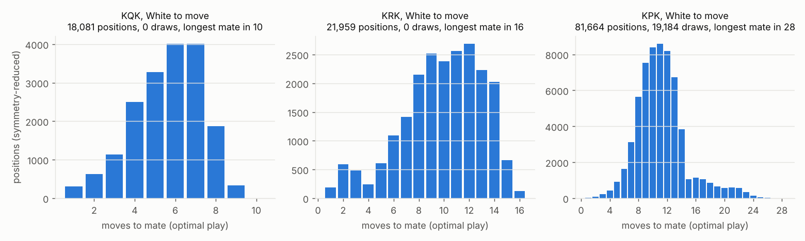
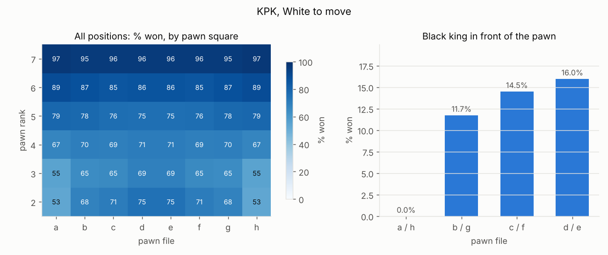
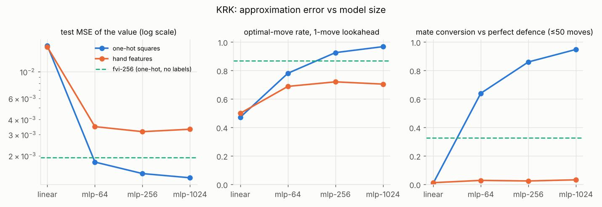
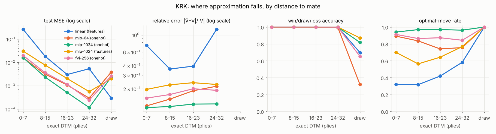
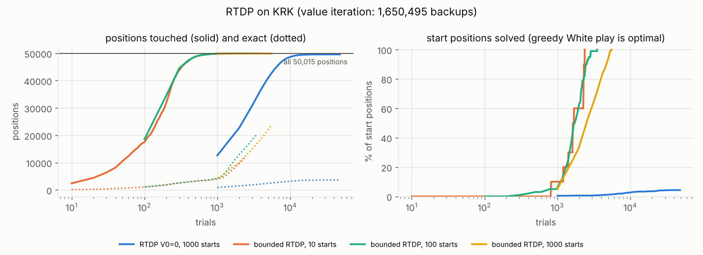
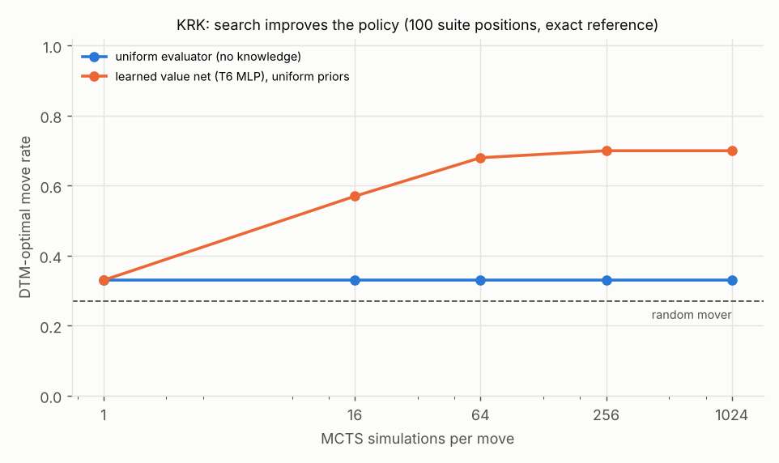

# Exact dynamic programming on small endgames

Vatsl's midsem section. Code: `alphachess/endgames/`. Every number here was produced by the
scripts listed in [Reproduce](#reproduce); raw results are in [`results/`](results/) and figures in
[`figures/`](figures/). The method follows the
[Endgame DP Primer](../../docs/Vatsl_Endgame_DP_Primer.html).

## 1. The endgame as a stochastic shortest path problem

A three-piece endgame (king and queen / rook / pawn against a lone king) is a finite,
deterministic, two-player zero-sum game:

- **State** `s`: the squares of the three pieces and the side to move.
- **Actions** `A(s)`: the legal moves (generated by python-chess).
- **Transition**: deterministic, `s' = f(s, a)`; the side to move alternates.
- **Termination**: checkmate (the side to move has lost), stalemate, or a capture that leaves
  bare kings (both draws). In KPK, a promotion leaves the table and enters KQK or KRK, whose
  already-solved values act as terminal costs; an under-promotion to a knight or bishop is a draw.

From the winner's point of view this is a stochastic shortest path (SSP) problem: reach a
terminal "mate" state at minimum cost (one unit per move), against an adversary. Positions from
which the stronger side cannot force mate (the side to move can take the piece, stalemate, KPK
draws) are the states with no proper policy for the attacker. We ignore the 50-move rule; Syzygy's
WDL tables account for it, but no 3-piece position is affected (the Syzygy check below agrees on
every position).

## 2. Bellman equation and the two-player (negamax) form

Store every value from the point of view of the **side to move** (`docs/INTERFACES.md` §4). What
is good for the opponent is bad for me, so the sign flips across each move:

```
V(s) = max_{a ∈ A(s)}  − γ · V(f(s, a))          V(checkmated) = −1,   V(draw) = 0
```

With `γ = 0.9` the fixed point is `V*(s) = ± γ^dtm(s)`: `+γ^d` if the side to move mates in `d`
plies, `−γ^d` if it is mated in `d` plies, `0` for a draw. The discount makes the winner prefer the
fastest mate and the loser the longest resistance. Our tables store the same information without
floating point: win/draw/loss (WDL) plus depth to mate (DTM) in plies, and the optimal move.

## 3. Value iteration vs retrograde analysis

**Value iteration** starts from `V = 0` and applies the Bellman backup to *every* position in each
sweep until nothing changes. On KRK it needs 33 sweeps, one per DTM level, and 1.65 M backups, most
of which change nothing.

**Retrograde analysis** (`solve.py`) computes the same fixed point by walking moves backwards from
the mates (a count-down BFS):

1. seed checkmates (loss, DTM 0) and known leaves (bare kings, promotions into KQK/KRK);
2. at level `d`, every predecessor of a position *lost* at DTM `d` is *won* with DTM `d + 1`
   (first resolution is the fastest mate);
3. every predecessor of a position *won* at DTM `d` loses one escape; when its counter of
   unresolved moves reaches zero, all its moves lose, so it is *lost* with DTM `d + 1` (the last
   child processed is the longest resistance);
4. whatever is never resolved is a draw.

Each move is walked backwards at most once: 0.52 M predecessor steps on KRK against 1.65 M
value-iteration backups. Successors and predecessors are stored once as CSR arrays and each level
is processed with NumPy array operations.

**Indexing** (`index.py`). Pawnless tables use the 8 symmetries of the board: the white king is
moved into the a1–d1–d4 triangle (10 squares), giving `2 × 10 × 64 × 64 = 81,920` slots instead
of 524,288. With pawns only the left-right mirror is valid (pawn on files a–d, ranks 2–7):
`2 × 24 × 64 × 64 = 196,608` slots. Illegal and non-canonical slots are masked.

## 4. RTDP

Real-time dynamic programming uses the same backup but only along simulated games (*trials*)
from chosen start positions, both sides playing greedily on the current table, ties broken by the
least-tried move, values stored in a dictionary. RTDP's guarantee is about the positions that good
play from the starts can reach, not the whole table.

A finding of this study: **plain RTDP with `V₀ = 0` (as in the primer) does not converge on KRK.**
Every White-to-move KRK position is a win, so 0 is a *pessimistic* guess for White. Once White
knows one winning line, untried moves (valued 0) never look better, so White never discovers
shorter mates. Black, for whom 0 is optimistic, does explore. One shared value cannot be
optimistic for both players. We therefore also run RTDP with two bounds per position, `U ≥ V* ≥ L`,
starting at `U = +1, L = −1`:

```
U(s) = max_a −γ L(next)        L(s) = max_a −γ U(next)
```

Each mover plays its optimistic move (`argmax −γ L(next)`), so both sides keep exploring, and
each trial's path is backed up in reverse. `L(s)` is the value the side to move can *guarantee*.
A start position is solved when `L(start)` equals the exact value. From then on, White's safe
greedy move is optimal along the whole line against perfect defence; we check this by playing it
out against the tablebase.

## 5. Results

### 5.1 Exact tables

Symmetry-reduced legal positions (`results/endgame_summary.csv`). Times are on one CPU core of the
cloud container: graph construction with python-chess, then retrograde analysis.

| Table | Side to move | Positions | Win | Draw | Loss | Longest mate | Build + solve |
|---|---|---:|---:|---:|---:|---|---|
| KQK | White | 18,081 | 100% | 0% | 0% | 19 plies (mate in 10) | 2.9 s + 0.09 s |
| KQK | Black | 28,056 | 0% | 10.3% | 89.7% | 20 plies | |
| KRK | White | 21,959 | 100% | 0% | 0% | 31 plies (mate in 16) | 2.7 s + 0.10 s |
| KRK | Black | 28,056 | 0% | 10.0% | 90.0% | 32 plies | |
| KPK | White | 81,664 | 76.5% | 23.5% | 0% | 55 plies (mate in 28) | 10.9 s + 0.18 s |
| KPK | Black | 84,012 | 0% | 41.9% | 58.1% | 56 plies | |

The longest mates match the known values (KQK mate in 10, KRK mate in 16, KPK mate in 28, the last
one including the KQK phase after promotion). With White to move, every KQK and KRK position is a
win; the Black-to-move draws are exactly the stalemates and the positions where the king can take
an undefended piece.



**KPK.** Over all positions the pawn's rank matters most (53–75% won with the pawn on rank 2, 96–97%
on rank 7). The classic rook-pawn result appears when the defending king stands in front of the
pawn: White then wins **0%** of rook-pawn positions, against 11.7%, 14.5% and 16.0% for b-, c- and
d-pawns. Textbook positions in the tests (key squares, opposition with either side to move, rook
pawn with the king in the corner) all come out right.



### 5.2 Verification

`results/verification.csv`, every check on every legal position unless stated:

| Check | KQK | KRK | KPK |
|---|---|---|---|
| WDL vs Syzygy (3-piece tables) | 46,137 / 46,137 | 50,015 / 50,015 | 165,676 / 165,676 |
| Bellman consistency (each value = negamax backup of its successors; best move one ply closer to mate) | 100% | 100% | 100% |
| Independent synchronous value iteration (γ = 0.9), WDL and DTM | 100% (21 sweeps) | 100% (33 sweeps) | 100% (39 sweeps) |
| Stockfish 16, 1,000 random positions, 300k nodes, no tablebases: shorter mate found / mate in a drawn position | 0 / 0 | 0 / 0 | 0 / 0 |

Stockfish without tablebases is a one-sided check: on the same samples it reported the exact DTM
for 394 / 147 / 49 positions, a longer mate for 217 / 178 / 89, and no mate within its node budget
for 327 / 609 / 536 (KQK / KRK / KPK). It never contradicted a table. The exact DTM proof is the
Bellman check together with value iteration.

### 5.3 Approximation study (KRK)

Target: the exact `γ^dtm` value (γ = 0.9) of all 50,015 KRK positions, random 80/20 train/test
split (seed 0), 40 epochs of Adam. Inputs: one-hot squares (193 dims) or 12 hand features (king
distances, black king's distance to edge and corner, rook–king distances, rook attacked /
defended, rook on the king's line, side to move). The fitted value iteration (FVI) learner never
sees an exact label: for 60 rounds it regresses on `max_a −γ V̂(next)` computed from its own
predictions, with only checkmate/stalemate/bare kings known from the rules. Lookahead moves pick
`argmax −V̂(next)`. Mate conversion: 500 won White-to-move test positions, White plays the lookahead
move, Black the tablebase's defence, 50 moves. Full table: `results/approx_metrics.csv`.

| Model | Inputs | Params | Test MSE | Rel. error | WDL acc. | Optimal move | Mate conversion |
|---|---|---:|---:|---:|---:|---:|---:|
| linear | one-hot | 194 | 0.0164 | 0.72 | 93.4% | 47.2% | 0.8% |
| MLP-64 | one-hot | 16.6k | 0.0018 | 0.19 | 96.0% | 78.1% | 64.0% |
| MLP-256 | one-hot | 116k | 0.0014 | 0.15 | 98.4% | 92.6% | 86.0% |
| MLP-1024 | one-hot | 1.25M | 0.0013 | 0.13 | 99.0% | 96.8% | 94.8% |
| linear | features | 13 | 0.0161 | 0.74 | 98.3% | 49.9% | 1.2% |
| MLP-64 | features | 5.1k | 0.0035 | 0.25 | 99.6% | 68.9% | 2.8% |
| MLP-256 | features | 69k | 0.0032 | 0.22 | 99.97% | 72.0% | 2.4% |
| MLP-1024 | features | 1.06M | 0.0033 | 0.23 | 99.3% | 70.5% | 3.2% |
| FVI-256 (no labels) | one-hot | 116k | 0.0019 | 0.19 | 98.1% | 86.9% | 32.8% |




**Where approximation fails.**

- **Drawn positions.** These are mostly positions where Black can take an undefended rook. Their
  WDL accuracy drops to 32% (MLP-64, one-hot) and 82% (MLP-1024, one-hot), against ≥ 99.4% for the MLPs in
  every decisive DTM bucket. The hand features, which contain an "attacked and undefended" flag, reach
  87–99% there. Rook-hanging tactics are the hardest thing to *classify*.
- **Long mates, for small models.** Relative value error grows with DTM (MLP-64: 0.12 for DTM
  0–7, 0.22 for DTM 24–32), and mate conversion falls with it (MLP-64: 91% for DTM 0–7, 55–60%
  beyond DTM 16; MLP-256: 63% for DTM 24–32). Converting needs up to 16 correct moves in a row, so
  small per-move error rates compound. MLP-1024 does not degrade (91–99% in every bucket).
- **Hand features know *who* wins but not *how*.** Their WDL accuracy is the best of all models,
  yet they convert under 4% of wins and under 1% beyond DTM 8. The features don't describe the rook's
  cut-off of the king, so the value plateaus and the lookahead shuffles.
- **Bootstrapping errors accumulate away from the mates.** Fitted VI converts 100% of DTM 0–7
  starts, 68% of DTM 8–15, 20% of DTM 16–23 and 0% of DTM 24–32.
- **Scale helps with one-hot inputs.** MLP-1024 converts 94.8%. This is the supervised network's
  bet in miniature: enough capacity on raw inputs beats hand-built features.

### 5.4 Value iteration vs retrograde analysis vs RTDP (KRK)

`results/rtdp_results.md`; γ = 0.9; RTDP starts are random White-to-move positions (seed 0).

| Method | Starts | Work | Backups | Positions touched | Exact entries | Converged |
|---|---:|---|---:|---:|---:|---|
| Retrograde analysis | all | 33 levels | 524,507 (predecessor steps) | 50,015 | 50,015 | yes |
| Synchronous value iteration | all | 33 sweeps | 1,650,495 | 50,015 | 50,015 | yes |
| RTDP, one value, V₀ = 0 (primer) | 1,000 | 48,322 trials | 2,294,921 | 49,619 | 3,649 | **no** (cap of 50 passes) |
| RTDP with bounds | 10 | 2,371 trials | 605,122 | 49,928 | 11,602 | yes |
| RTDP with bounds | 100 | 3,517 trials | 646,850 | 49,923 | 20,403 | yes |
| RTDP with bounds | 1,000 | 5,566 trials | 679,356 | 49,923 | 23,802 | yes |



Bounded RTDP solves the starts with 37–41% of value iteration's backups and leaves half or more of
the entries inexact, as RTDP should. But it still *touches* almost every position. On a graph this
small, with long cyclic trials (300-ply cap) and optimistic exploration on both sides, the relevant
set is nearly everything. Retrograde analysis is still the cheapest exact method here. RTDP's
saving needs a much larger state space or a narrow start distribution, which is the Phase 2
setting (French-only self-play).

### 5.5 Search improves the policy, with exact ground truth

Agriya's `MCTSPlayer` (PUCT, c = 1.5) on the 100 KRK positions of the frozen suite
(`data/endgames/suite.fen`, stratified by DTM), scored with `evaluate_positions` and our exact
reference analyser (`results/mcts_vs_sims_krk.csv`).

| Player | Simulations: 1 | 16 | 64 | 256 | 1024 |
|---|---:|---:|---:|---:|---:|
| MCTS, uniform evaluator: DTM-optimal move rate | 33% | 33% | 33% | 33% | 33% |
| MCTS, learned value (T6 MLP-64, uniform priors) | 33% | 57% | 68% | 70% | 70% |
| MCTS, learned value: `evaluate_positions` top-move agreement | 22% | 38% | 49% | 51% | 47% |

A random mover scores 27%. `MCTSPlayer` with the `DPEvaluator` (16 simulations) and the
`TablebasePlayer` both score 100%, as they should.



With the uniform evaluator every non-terminal leaf is worth 0. KRK mates are 10–32 plies deep, far
beyond what 1,024 simulations can see, so visits spread evenly and the move choice falls to the
tie-break: search with no knowledge does not help. With an imperfect learned value at the leaves,
the same search more than doubles the optimal-move rate from 1 to 64 simulations. Search turns an
approximate value function into a better policy. This is the policy-improvement step of
AlphaZero, measured against exact ground truth. ("Top-move agreement" counts only the table's
single best move. Most KRK positions have several equally fast mates, so the optimal-move rate is
the fairer measure.)

## Reproduce

```bash
pip install -e ".[dev,torch]" && sudo apt-get install -y stockfish   # Stockfish is optional
python -m scripts.solve_endgame --table all     # tables -> data/endgames/*.npz, summary, figures (~20 s)
python -m scripts.verify_endgame --table all    # Syzygy, Bellman, VI, Stockfish (~30 min with Stockfish;
                                                #   --stockfish-samples 0 skips it: ~1 min)
python -m scripts.run_approx                    # approximation study (~6 min on 2 threads)
python -m scripts.run_rtdp                      # VI vs retrograde vs RTDP (~5 min)
python -m scripts.run_endgame_mcts              # MCTS vs simulations on the KRK suite (~3 min)
pytest -q && pytest -q -m slow                  # tests (fast suite ~25 s; slow adds KPK, Stockfish)
```
